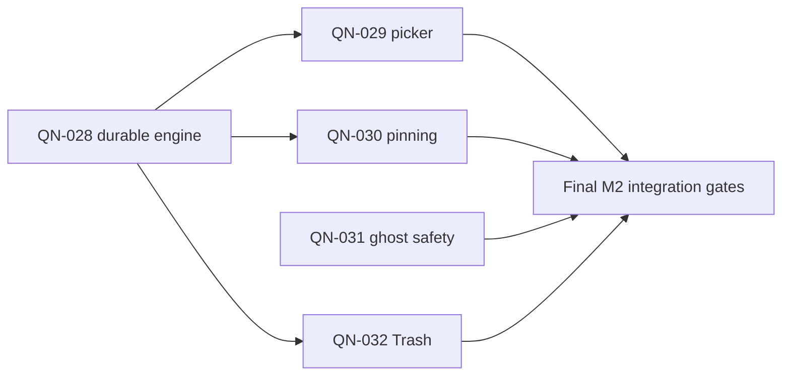

# Quicknote v2 Milestone M2 Implementation Plan

> **For agentic workers:** REQUIRED SUB-SKILL: Use superpowers:subagent-driven-development (recommended) or superpowers:executing-plans to implement this plan task-by-task. Steps use checkbox (`- [ ]`) syntax for tracking.

**Goal:** Complete QN-028–QN-032 with reliable expiration, pinning, memory-only ghosts and recoverable, keyboard-accessible Trash, verified against the M2 acceptance catalog.

**Architecture:** Keep the current Go package, EditorDraft identity, CAS save queue, typed commands and overlay/layout/action registry. Add a small pure lifecycle layer, transactional SQLite lifecycle methods and focused TUI lifecycle controllers. Establish the durable metadata/migration foundation first, then integrate one QN task at a time.

**Tech Stack:** Go ≥1.25.9, Bubble Tea 1.3.10, current Lip Gloss/Bubbles, go-sqlite3 with CGO and `sqlite_fts5`; standard-library time/location and existing Unicode helpers. No dependency upgrades.

**Spec:** `docs/QUICKNOTE_V2_SPEC.md` v1.1.0 §§3–5, 7–8, 10, 12, 14 and `docs/superpowers/specs/2026-10-12-m2-lifecycle-design.md` (approved v1.1.0 amendment).

**Baseline:** local and GitHub `dev/v2` = `0778085c5815d56a439550ccd9e898fa79935dc1`; `main` = `d3e5a119cdf12ec99fcc14a62545f60729adea54`. Inspected 2026-10-12. Existing untracked `.config/`, `.local/`, `vim_profile.log` belong to the user. No M2 implementation or new tests have run during planning.

**Approval:** The user approved this plan, its schema/privacy amendment and agent execution on 2026-10-12. Execution is underway on dev/v2: QN-028 is accepted, QN-029 is accepted, then QN-030–032 follow sequentially. Historical baseline below records planning state; the living ledger records current evidence.

## Global Constraints

- "Preserve stable note IDs, per-note undo/dirty state, CAS revisions, async request generations and 72-hour trash recovery."
- "Use temporary synthetic SQLite fixtures; **never test destructive migrations or deletion against real notes**."
- "Back up an existing database with SQLite's backup/VACUUM INTO mechanism before modifying schema or retention behavior."
- "Do not promise secure erasure; do not insert ghost notes into the database. Do not alter CLI stdout in quiet mode."
- "Use keyboard-accessible paths for all new features. Preserve compatibility or document any intentional keymap change."
- "After every task, update docs/IMPLEMENTATION_PROGRESS.md with branch/SHA, changed files, exact tests PASSED/FAILED/NOT RUN, risks, DB version, and next ready task. Commit it with the implementation."
- Work/integrate/push only `dev/v2`; never alter or merge `main`. One QN ID owns each implementation commit. Isolated worker branches/worktrees may feed `dev/v2`; only the coordinator integrates or pushes.
- All SQLite/shell/file operations stay outside Update/View. New workers carry immutable draft key, note ID, revision, local version and request generation; validate acknowledgments against their owner.
- Do not implement M3 palette/sidebar/search, M4 general mouse/theme work or M5 general export/CLI/shell tasks. M2 uses existing Commands/confirmation interfaces and narrow lifecycle hooks.

## Review Focus

1. Editing or switching notes while a sweep/metadata operation completes: retain the newest local text/history and apply only matching metadata. QN-028 model/process tests own this.
2. Restored/pinned/preset-overridden notes containing unchanged `#kill`: no deadline can resurrect after restart or normal saves. QN-028 precedence plus QN-030/032 round-trip tests own this.
3. Legacy/corrupt timestamps and failed backups/migrations: preserve every note and block unsafe inference, partial schema advances and premature purge. QN-028 fixture/failure tests own this.
4. Clock jumps, DST folds/gaps and the exact 72-hour boundary: absolute time remains stable; ambiguous local custom input is rejected; equal-to-cutoff Trash stays recoverable. QN-029 date tests and QN-028/032 maintenance tests own this.
5. Ghost conversion/discard plus pending save/export/filter results: no implicit persistence or orphan content-bearing session references; a persisted original stays recoverable. QN-031 privacy/lifecycle model tests own this.

## Delivery order and future agents



Recommended implementation order: **028 → 029 → 030 → 031 → 032**. QN-031's spec prerequisites are already met; ordering it after the shared foundation avoids overlapping lifecycle integration. The diagram expresses prerequisites, not permission to edit shared files simultaneously.

Future agent protocol:

- Coordinator owns the working queue, approved amendment, integration order, living ledger/handoff and `dev/v2`. Re-read current instructions before execution; this user explicitly selected all M2 tasks, so the single-task rule means one task at a time, not stopping after the first task.
- One implementer per QN task, in an isolated worktree branched from the latest integrated head. Give it only the full spec/design, its plan section, required contracts, allowed files and prior reviewed commit SHA. Preserve session/model policies for tool/model selection.
- Use independent spec and code reviewers per completed task, with a final milestone review. With four agent slots, coordinator + implementer + two reviewers fit; reviews of the same immutable commit can run in parallel. Test/PTY runners may run in parallel on immutable commits with independent temporary HOMEs. Avoid running full suites redundantly without new findings.
- Implementation of 029/030/031/032 concurrently is optional only with explicit, disjoint file ownership and coordinator-owned shared-file integration; default is sequential because all touch actions/async/model state. Never share a writable implementation checkout between agents.
- Only the coordinator updates the authoritative ledger and pushes. An implementation task is DONE only after review fixes, applicable full gates, integration into `dev/v2`, and exact published SHA evidence. Hold the next dependent task if acceptance is red.

## Shared interfaces and file boundaries

These are planned APIs, not declarations that they already exist. Use NoteID's current `int` alias and revisions `int64`. Keep existing NoteStore/CAS methods as compatibility adapters; add `LifecycleStore` and embed it in `NoteStore`, updating test stores deliberately. Do not replace the whole repository API with the illustrative master-spec interface.

QN-028 introduces in `lifecycle.go`:

```go
type Clock interface { Now() time.Time }
type RealClock struct{} // Now() returns wall time

type ExpirationSource string // "none", "directive", "preset"
type DeleteReason string     // "", "manual", "expired"
type Directive struct {
    Present bool
    Fingerprint string
    Duration time.Duration
}
type ExpirationChoice struct {
    Deadline *time.Time // nil means Never
    Source ExpirationSource
}
type RestoreMode int // RestoreWithoutTimer, RestoreResetDirective

type LifecycleChange struct {
    ID NoteID
    Revision int64
    DeletedAt time.Time
    Reason DeleteReason
}
type MaintenanceResult struct {
    Expired []LifecycleChange
    Purged []NoteID
}

func ParseKillDirective(content string) (Directive, error)
func DeriveExpiration(n Note, content string, now time.Time) (Note, error)
func FormatLifecycleTime(t time.Time) string
func ParseLifecycleTime(raw string) (time.Time, error)
```

`DeriveExpiration` is pure, returns an owned snapshot, and compares stored observation/source with current effective directive. It never logs content. Invalid input preserves the existing deadline/observation and sets review rather than inventing a timer; a parse issue is distinguishable from a repository save failure. The save transaction compares the actual expected persisted base, then persists the derived snapshot/content/tags together. New drafts derive against an empty base. Ghosts return before derivation/storage. `Note` gains ExpirationSource, ExpirationNeedsReview and DeleteReason fields; ExpiresAt stays `sql.NullString` for compatibility.

QN-028 introduces in `store_lifecycle.go`:

```go
type LifecycleStore interface {
    ApplyExpirationCAS(id NoteID, expected int64, c ExpirationChoice, now time.Time) (Note, error)
    ApplyPinnedCAS(id NoteID, expected int64, pinned bool, now time.Time) (Note, error)
    TrashSnapshotCAS(id NoteID, expected int64, reason DeleteReason, now time.Time) (Note, error)
    ExpireNoteCAS(id NoteID, expected int64, now time.Time) (Note, error)
    RestoreSnapshotCAS(id NoteID, expected int64, mode RestoreMode, now time.Time) (Note, error)
    DeleteTrashCAS(id NoteID, expected int64) error
    Maintain(now time.Time, protectedIDs []NoteID) (MaintenanceResult, error)
}
```

Implement store-level safety semantics here once; the owning 029/030/032 task adds its UI and task-specific regressions. Capture mutation result snapshots in the same transaction as the successful CAS, not through an unrelated later Get. Expose lifecycle methods through checked store wrappers, never a direct SQL TUI path. Keep `TrashCAS`/`RestoreCAS`/`SetPinnedCAS`/`SetExpirationCAS` wrappers where used by existing tests; change transitional behavior only with replacement assertions/decision log. Generic `PurgeCAS` stays distinct from new trash-only `DeleteTrashCAS`.

`migration_lifecycle.go` owns `migrateLifecycleV3(db *sql.DB, path string, existing bool) error` and verified backup. `db.go` supplies `openDatabase(path string, clock Clock) (*sql.DB, error)` with explicit-error startup/migration/maintenance; `initDB()` remains the current caller-compatible fatal adapter. `SQLiteStore` holds a Clock, and a `NewSQLiteStoreWithClock(db *sql.DB, clock Clock) *SQLiteStore` constructor supports tests; the existing constructor uses RealClock. Tests must not use process exits to exercise migration failures.

`tui_lifecycle.go` owns `requestMaintenance() tea.Cmd`, `receiveMaintenance(maintenanceResult) tea.Cmd`, `requestLifecycle(intent lifecycleIntent) tea.Cmd`, and `receiveLifecycle(lifecycleResult) tea.Cmd`. `lifecycleIntent` carries kind/expiration/restore/pin payloads, and immutable request/result structs carry key, ID, expected revision, version and generation plus snapshot/error. They extend existing dispatch points without a second save queue. Commands capture Clock/store/snapshot values; no worker captures mutable model state. QN-028 adds core maintenance; later tasks extend intent dispatch. Extend `drainTestCmd` with each new finite message type.

QN-029 adds in `ttl_picker.go`: `ResolveTTLInput(input string, now time.Time, loc *time.Location) (ExpirationChoice, error)`, pure preset/custom resolution; `openTTLPicker() tea.Cmd`, `ttlPickerKey(key string) tea.Cmd`, `ttlPickerView() string`, `lifecycleStatus() string`, `ttlStatusRegion() HitRegion`. `HitRegion` is a small cell-coordinate rectangle with ActionID defined in layout.go. The same status layout returns rendered text/region; View does not mutate it.

QN-030 adds `requestPinToggle() tea.Cmd` in `tui_lifecycle.go`. QN-031 adds `newGhostDraft(content string)`, `requestGhostConversion(disposition GhostDisposition) tea.Cmd`, `discardGhost()` in `ghost.go` (GhostDisposition = KeepOriginal or TrashOriginal). QN-032 adds `openRestorePicker()`, `requestDeleteForever()`, `requestUndoTrash()` in `trash_ui.go`; a TrashUndo record holds only ID/revision/expiry bound, never a second content copy. New modal states must extend keymap validation beyond the current stateConfirm loop limit.

## Task QN-028: durable TTL, migration and maintenance foundation

**Dependencies:** QN-010/011/012 DONE. **Acceptance:** T-07/T-20; retain T-05/06/08/13/17/18/19/31.

**Files:** create `lifecycle.go`, `store_lifecycle.go`, `migration_lifecycle.go`, `tui_lifecycle.go`, `lifecycle_test.go`, `lifecycle_migration_test.go`, `tui_lifecycle_test.go`, `lifecycle_process_test.go`; modify `db.go`, `store.go`, `main.go`, `tui.go`, `tui_async.go`, `async_test_helpers_test.go`, affected `cas_*test.go`/`db_test.go`/`store_migration_test.go`, spec/ledger/handoff. main.go changes are limited to error-safe initialization/common lifecycle save path; preserve flags, capture normalization and stdout.

- [x] **1. Baseline and amendment:** fetch/inspect `dev/v2`, read the complete governing docs, run baseline full suite, and record output. Apply only the approved v1.1.0 amendment and decision log. Confirm no production fixture paths before any test.
- [x] **2. Write failing parser/precedence tests:** named `TestQN028DirectivePrecedence`, `TestQN028UnsafeDirectiveReview`, `FuzzQN028KillDirective`. Literal fixture `#kill 15 mins` at 2026-10-12T12:00:00Z derives 12:15:00Z; unchanged save/restart keeps that deadline; edited `#kill 1 hour` derives 13:00:00Z. Preset overrides keep their deadline on removal; removing directive-owned TTL clears it. Test multiple directives (last valid), fences/inline code/comments, fractional durations and existing aliases, invalid/negative/zero/NaN/overflow input, pin/cancel observations and restored unchanged text. No parsing can panic or schedule unsafe deadlines.
- [x] **3. Write failing v3 fixture tests:** `TestQN028V3MigrationBackup`, `TestQN028MigrationRollback`, `TestQN028LegacyDeadlineImport`. Fixtures: empty, v0/v1/v2, partial legacy, missing FTS, duplicates, active/trash/pinned, malformed hash/start/expiry, explicit existing expiry, UTC/non-UTC formats. Preserve IDs/content/tags/FTS/timestamp bytes/revisions, normalize valid deadlines and classify uncertain data for review. Reopening v3 performs no import/reset. Simulate backup/DDL failure; v2 user_version and rows remain unchanged. Open verified backup, recover with SQLite VACUUM INTO, compare synthetic rows/tags/version and integrity. Test existing backup path never overwrites a prior backup; use unique names and validate the newly created snapshot before proceeding.
- [x] **4. Write failing store/clock/concurrency tests:** `TestQN028T07RestartExpiresAll`, `TestQN028MaintenanceRetentionBoundary`, `TestQN028LifecycleCASRace`. At deadline, all due active unpinned notes soft-delete once with reason expired; future/pinned/review/trashed notes do not. Another connection/process races content/pin/TTL with expiry; one valid state transition wins without losing the winner's data or bypassing CAS. Two sweep processes cannot advance the same deletion time/revision twice. At deleted+72h retain; at +72h+1ms purge; malformed deletion times never purge. Trigger failure rolls back notes/tags/FTS. Use a coarse SQL candidate cutoff plus exact Go time verification inside the transaction for mixed legacy deletion formats; do not rely on approximate SQLite datetime precision for final deletion. Avoid unbounded SQL placeholders for protected IDs.
- [x] **5. Write failing model tests:** `TestQN028DirtyDraftExpiry`, `TestQN028StaleMaintenance`, `TestQN028MaintenanceInOverlay`. Protect active/retained dirty/failed/saving drafts in bulk workers; due drafts save latest content before expiry. Failed/conflicting saves remain actionable and unexpired locally. Type or open a note after a worker starts, complete it after edits, and keep buffer/history/dirty state. Never discard success of a late write; reconcile its owner and offer copy recovery if the row is now Trash. Ticks while Help/Search/Commands are open still sweep other notes; only one sweep can run. View has zero I/O and no expiry/hash mutation. Test clock jumps and nil/test-constructor defaults explicitly.
- [x] **6. Run targeted red:** `go test -tags sqlite_fts5 -count=1 -run 'TestQN028' .`; identify actual missing behavior/compile seams, then implement the interfaces/migration/store/async integration above. Keep migration separate from expiry: backup and migration first, maintenance afterwards. Preserve original v1 backup contract while adding a verified pre-v3 backup for existing v2. Start with explicit-error open helper so failed migration is testable. Configure foreign-key enforcement per connection (including pooled connections), inspect actual legacy table constraints, and report/handle fixture anomalies without deleting notes. Do not claim foreign_key_check verifies a constraint that does not exist.
- [x] **7. Complete save/read integration:** derive metadata once in the shared content/tag transaction; extend all full-note/list/search snapshot scans and clone/ack preservation for source/review/reason. Unrelated typing after a save starts must preserve newly edited lifecycle metadata too. Remove tick-based KillStart reset and ResetLegacyTimer load behavior; countdown will use ExpiresAt. Route startup and periodic maintenance through store methods, replace ad hoc startup cleanup, and gate before initial listing. Legacy kill_start import occurs only once under migration. Update old tests that expect schema 2/timer reset to explicitly expect schema 3/no reset while retaining ID/text/CAS/backup assertions.
- [x] **8. Verify green/full gates:** run targeted tests, full common gates below, one-second directive fuzz, and 20 repetitions of QN-028/CAS races. Include built-binary quiet positive/negative CLI assertions because initialization/save lifecycle changed. Document backup recovery evidence and NOT RUN platform checks. Update ledger/handoff and commit `QN-028: persist lifecycle deadlines and safe maintenance` with exact files/evidence.

## Task QN-029: TTL picker and countdown

**Dependencies:** QN-028 integrated/reviewed plus QN-014/017 DONE. **Acceptance:** T-20; supporting T-25/27/28.

**Files:** create `ttl_picker.go`, `ttl_picker_test.go`, `ttl_picker_model_test.go`; modify `tui_lifecycle.go`, `tui.go`, `actions.go`, `keymap.go`, `layout.go`, `overlays.go`, `async_test_helpers_test.go`, `docs/KEYBOARD.md`, ledger/handoff. Consume QN-028 Clock, ApplyExpirationCAS and immutable request/result contract; expose picker/status APIs above.

- [x] **1. Baseline then failing resolver tests:** `TestQN029T20Presets`, `TestQN029DSTCustomInput`. At 2026-10-12T12:00:00Z, 15m/1h/3d/7d yield 12:15/13:00 and October 15/19 at noon; Never is nil. Today in America/Los_Angeles ends at local 23:59:59. Test March 8 and November 1, 2026 DST dates: calendar day end differs from elapsed 24h. Reject `0m`, `-1h`, overflow, trailing junk and past dates; require explicit offsets for 2026-03-08 02:30 gap and 2026-11-01 01:30 fold. Equivalent explicit-offset RFC3339 instants produce expected UTC. Add exact one-second-midnight guard and clock change while the menu is open.
- [x] **2. Failing model/accessibility tests:** `TestQN029PickerCancelNoMutation`, `TestQN029StaleTTLResult`, `TestQN029TTLStatusHitRegion`. Default cursor choice cannot write without review/confirm. Esc preserves ID/buffer/history/cursor/save state. Dirty note saves first; metadata conflicts preserve both text and old deadline. An edit/switch/expiry during confirmation cancels stale intent; late successful mutations reconcile their source snapshot. Keyboard Commands action `ttl.set`, configurable shortcut and status click all enter the same picker. Click only within the rendered unclipped region; tiny terminals omit hit targets when no visible label fits. Actions are disabled in Trash/ghost and finite TTL on pinned notes explains unpinning.
- [x] **3. Red → implement:** use existing overlay frames/panels with visible Esc, selection, custom input and default-Cancel confirmation showing absolute local instant/zone/offset. Resolve relative preset at confirmation. Use registry intents for new actions rather than inventing key-message mappings. Add collision-free configurable action binding without changing existing default/legacy chords. Extend keymap validation/cancel guarantees to all new states. Generate help from registry.
- [x] **4. Pure status:** show Expires in/Pinned/expiration needs review beside real Saved/Saving/Unsaved/Failed/Conflict labels. countdown = saved deadline minus captured timerNow; View never reparses directives or changes metadata. A transient toast must not hide a persistent save failure. Test mono text and clock jumps without rewriting deadline.
- [x] **5. Green and commit:** run resolver/model tests, four-size/tiny-size panel tests, no-mouse keyboard model pass, common full gates and built-binary keyboard/TTL-click PTY checks. Record textual snapshots and exact commands; commit `QN-029: add expiration picker and persisted countdown` with ledger/handoff.

## Task QN-030: pinning

**Dependencies:** QN-028 integrated; execute after QN-029 to reuse lifecycle status/controls. **Acceptance:** T-20.

**Files:** create `pinning_test.go`; modify `tui_lifecycle.go`, `actions.go`, `tui.go`, `ttl_picker.go` only for availability/status, ledger/handoff. Store semantics are QN-028 ApplyPinnedCAS; no sidebar implementation.

- [ ] **1. Baseline/failing tests:** `TestQN030T20PinSuppressesExpiry`, `TestQN030UnpinNeverRearms`, `TestQN030PinRace`. Pin a note due in 15m: atomically set pinned, clear deadline/source, observe its current directive and advance revision once; sweep past deadline/restart/save leaves it active. Editing `#kill` while pinned cannot leave a hidden deadline. Confirm unpin without a timer; cancel preserves pin/revision. Unpin restart with unchanged directive stays active; setting a new TTL afterwards works. Manual delete of pinned note still moves it into recoverable Trash. Failures/CAS races do not clear someone else's updated metadata.
- [ ] **2. Red → implement UI:** enable `note.pin` with pin/unpin title and explanations in current Commands, route through shared save/metadata dispatcher, default Cancel on unpin confirmation showing “no timer”. Dirty typing during result retains text. Disable in ghost/Trash. Expose Note.IsPinned in normal list/search results and reusable status/actions for future QN-024 sidebar. Do not reorder all notes or invent sidebar/search filters now.
- [ ] **3. Green/full gates/commit:** targeted tests plus T-20 repetitions, common full gates and keyboard-only pin/unpin/cancel smoke. Update decision notes for cleared expiry, ledger/handoff; commit `QN-030: pin notes without resurrecting expiration`.

## Task QN-031: ghost creation and safe conversion

**Dependencies:** QN-005/010/013 DONE; execute after QN-028 so safe Trash conversion and shared metadata interfaces are available. **Acceptance:** T-22/T-23.

**Files:** create `ghost.go`, `ghost_test.go`, `ghost_model_test.go`; modify `actions.go`, `tui_lifecycle.go`, `tui_async.go`, `overlays.go`, `draft.go`, `tui.go`, `keymap.go` only if required for new modal keys, `async_test_helpers_test.go`, `README.md` privacy paragraphs, ledger/handoff. Use newGhostDraft/requestGhostConversion/discardGhost and existing independent SessionID keys.

- [ ] **1. Baseline/failing creation/privacy tests:** `TestQN031T22NoGhostWrites`, `TestQN031GhostDiscardClearsReferences`. Start New Ghost (`ghost.new`) before typing a unique synthetic sentinel. Type/paste/math/undo/autosave/maintenance/search/navigation/exit and inspect notes/tags/FTS, files and captured logs: sentinel never appears. A store spy fails if ghost content reaches a write method; ordinary persisted-note search reads are allowed. Two ghosts retain independent history/dirty/session IDs. Discard removes buffers/history/pending output references from draft/list/session state; restarting sees only original persisted notes. New Ghost can preserve a previous non-ghost dirty draft via its ordinary save gate without storing ghost content.
- [ ] **2. Failing conversion tests:** `TestQN031T23KeepOriginal`, `TestQN031TrashOriginalRecoverable`, `TestQN031StaleConversion`. Ctrl+G shows choices Cancel/default safe duplicate/explicit Trash original. Cancel does nothing. Safe duplicate retains original row ID/content/tags/FTS and creates distinct ID-zero ghost; no ghost insertion. Dirty originals resolve save/CAS first, failed save prevents transition. Explicit Trash disposition warns about prior persistence, soft-deletes original with 72h recovery and same ID. Race external save or source edits during conversion: keep newer text/history and do not convert/delete another note. Late successful writes are reconciled rather than ignored. A ghost-to-persisted transition needs explicit confirmation; cancel stays ghost, confirm creates exactly one ordinary note.
- [ ] **3. Failing external-output guards:** `TestQN031ExplicitOutputConfirmation`. Copy/export of ghost content warns and defaults Cancel before invoking any external writer; cancel writes zero bytes. Confirm allows only that explicit output and does not create a note/tag/index entry. Capture identity/version in these confirmations, avoid bypass by Commands/rebound keys, and cancel pending export checks on ghost discard. Do not redesign clipboard backends or shell execution; shell filters remain explicit and logging-free.
- [ ] **4. Red → implement:** enable ghost.new and replace destructive legacy toggle/ghost mutation path. Allocate memory identity before edits, retain source session/metadata, clear persisted TTL/pin/revision fields on the ghost. Keep ghost expiry/pin disabled; #kill text is inert. Remove conversion's PurgeCAS call. Display “Ghost · unsaved by design” and honest persistence limitations. Update affected QN-017 ghost-confirmation tests to the approved new recovery policy without weakening cancel/stale guards.
- [ ] **5. Green/full gates/commit:** T-22/T-23 including negative external-write cases, independent sentinel DB/files/log audit, common full gates, keyboard ghost creation/convert/cancel/exit PTY. Update scoped README privacy wording, ledger/handoff; commit `QN-031: create memory-only ghosts and preserve originals`.

## Task QN-032: Trash restore, undo and permanent deletion

**Dependencies:** QN-005/017 DONE, QN-028 integrated; integrate last for cross-lifecycle acceptance. **Acceptance:** T-21/T-31; retain T-05/17 and keyboard access.

**Files:** create `trash_ui.go`, `trash_ui_test.go`, `trash_lifecycle_test.go`; modify `actions.go`, `tui_lifecycle.go`, `tui_async.go`, `tui.go`, `overlays.go`, `keymap.go`, `async_test_helpers_test.go`, relevant transitional restore/empty-note tests, docs/KEYBOARD.md, ledger/handoff. Consume RestoreSnapshotCAS/DeleteTrashCAS/TrashSnapshotCAS; add TrashUndo intent/state, no bulk permanent-delete feature.

- [ ] **1. Baseline/failing read-only/restore tests:** `TestQN032T21RestoreWithoutTimer`, `TestQN032RestoreResetTimer`, `TestQN032TrashReadOnly`. Deleted notes reject typing/paste/formatting/math and show reason/deletion/recovery deadline with Restore/Delete forever actions. All paths including search Enter establish Trash identity/read-only state. Default restore clears expiry, remembers unchanged directive and never rearms on save/restart/unpin. Reset with `#kill 15 mins` at noon creates 12:15 deadline; invalid/unknown stored timer does not offer reset. Restoring pinned notes respects pin suppression. Cancel modifies nothing; stale revision/remote purge produces a visible recoverable error.
- [ ] **2. Failing undo/retention/delete tests:** `TestQN032T31UndoSameID`, `TestQN032DeleteForeverGuard`, `TestQN032EmptyNoteTrash`. Two identical notes delete independently. Undo targets only latest recorded deletion's ID/revision, restores without a timer and retains appropriate note history; it cannot overwrite a remote restore/edit. Undo remains possible before timed purge, including the exact 72-hour boundary; afterwards report unavailable without inserting a replacement. Delete forever rejects active notes, defaults Cancel, checks trash state/revision at execution, and atomically removes only that note/tags/FTS. Trigger/permission failure leaves all data recoverable. All ordinary deletes, including empty persisted notes, use soft Trash; ID-zero/ghost discard never creates Trash. New deletion records replace previous Undo target without confusing duplicate content.
- [ ] **3. Red → implement:** enable `trash.deleteForever`, route Ctrl+R through restore choices and register `trash.undoLast` accessible from current editor/Trash Commands with a disabled explanation when unavailable. Do not hijack editor Ctrl+Z (still per-draft text undo). Add delete/restore metadata to pure status, confirmation default Cancel and request identity/version/revision guards. Return to Trash after permanent deletion, with useful empty state; failed action retains selected note. Preserve draft/history during async moves/undo and retain local recovery on external expiry.
- [ ] **4. Green/full gates/commit:** run T-21/T-31/T-05/CAS races, four-size read-only/restore/delete panels, keyboard-only routes under default and legacy profiles, common full gates, synthetic PTY delete/undo/restore/reset/cancel/confirmed forever checks. Document intentional empty-note safety change, next READY task and DB v3; commit `QN-032: finish recoverable Trash and confirmed permanent delete`.

## Common verification gates (after each task)

Run with the current supported toolchain, GCC/CGO, and FTS5. Tests may use temporary cache directories if necessary, but never point synthetic HOME at production data. Do not overwrite HOME globally in the agent process. Each failed gate is recorded by name/reason; no DONE status on red acceptance.

```zsh
CGO_ENABLED=1 go test -tags sqlite_fts5 -count=1 ./...
CGO_ENABLED=1 go test -tags sqlite_fts5 -race -count=1 ./...
CGO_ENABLED=1 go vet -tags sqlite_fts5 ./...
CGO_ENABLED=1 go build -tags sqlite_fts5 -o /tmp/quicknote-m2 .
git diff --check
# Run gofmt on changed Go files; gofmt -l must produce no changed-file names.
```

Migration/store gates additionally verify synthetic backups/recovery, note/tag/FTS counts, PRAGMA user_version=3, integrity_check/foreign_key_check and rollback. A missing/failed FK pragma is not a passing check. Capture baseline fixture expectations before changing them. Use bound SQL time parameters and caller clock, not CURRENT_TIMESTAMP for new lifecycle operations.

UI gates cover 120×40, 80×24, 50×12, 25×5 and 1×1/2×2, nested overlays, Escape, visible choice/footer and clipped/offscreen hit targets. Every new action has a Commands/keyboard route in default and legacy profiles; confirm a user-custom keymap still validates. Record text snapshots. Human terminal checks are distinct from scripted PTY evidence.

## Final M2 acceptance and handoff

After all five tasks integrate, run these once on the final tree (repeat only after new changes/failures):

```zsh
CGO_ENABLED=1 go test -tags sqlite_fts5 -count=1 ./...
CGO_ENABLED=1 go test -tags sqlite_fts5 -race -count=1 ./...
CGO_ENABLED=1 go vet -tags sqlite_fts5 ./...
CGO_ENABLED=1 go build -tags sqlite_fts5 -o /tmp/quicknote-m2 .
CGO_ENABLED=1 go test -tags sqlite_fts5 -count=20 \
  -run 'TestQN02[89]|TestQN03[012]|TestQN011T17|TestQN012(T02|T24)|TestQN048' .
CGO_ENABLED=1 go test -tags sqlite_fts5 -run '^$' \
  -fuzz '^FuzzQN028KillDirective$' -fuzztime=1s -parallel=2 .
CGO_ENABLED=1 go test -tags sqlite_fts5 -run '^$' \
  -fuzz '^FuzzQN016SourceRows$' -fuzztime=1s -parallel=2 .
git diff --check
```

Add reproducible scripts `tests/m2_pty.py` and `tests/m2_cli.py`, owned by the coordinator/test agent, with temporary synthetic HOMEs and bounded process timeouts. Support terminal capability responses; never dump source note contents in normal failure logs. Invoke with `python3 tests/m2_pty.py /tmp/quicknote-m2` and `python3 tests/m2_cli.py /tmp/quicknote-m2`.

PTY scenarios: short #kill expires an inactive note while another is edited; timer picker/absolute confirmation/Never; pin/unpin; New Ghost no DB sentinel; safe conversion preserving original; Trash read-only/undo/restore choices/delete-forever default Cancel; all four sizes and nested Escape. For 72-hour/DST scenarios use clock/model/store fixtures rather than changing system time or waiting in PTY. SQLite lock during a pending save/metadata operation must allow typing/resize and retain the latest draft. Concurrent external expiry must not lose local text.

CLI scenarios: quiet creation/append/startup with due notes, stdout/stderr/exit contract, injected write/migration/maintenance failure, unchanged content/revisions on error, persisted directive deadline not reset by unrelated append. CLI capture whitespace remains the legacy QN-040 responsibility. Human Fedora/Zsh/Kitty/tmux/clipboard matrix and release benchmarks are NOT RUN unless actually executed; no latency claim from correctness tests.

Milestone completion checklist:

- [ ] QN-028, 029, 030, 031, 032 each have accepted implementation commits plus ledger evidence and exact published SHAs.
- [ ] T-07/20/21/22/23/31 pass, and required existing identity/Unicode/CAS/async/math/migration regressions stay green.
- [ ] v2 synthetic data upgrades to v3 with a verified recoverable backup; failure preserves originals; legacy uncertain deadlines cannot delete notes.
- [ ] Ghost sentinel absent from DB/index/logs/files unless the test deliberately confirms an explicit output; retained originals and 72-hour Trash proven.
- [ ] Final independent milestone review has no unresolved critical/important findings.
- [ ] Final local `dev/v2` matches published `origin/dev/v2`; `main` stays unchanged; pre-existing untracked files remain untouched.
- [ ] Update SESSION_HANDOFF and LOCAL_TESTING for schema 3, M2 commands/tests, failures/NOT RUN checks and next ready task. Refresh stale AGENTS continuation wording without changing its safety rules. Recommend QN-018 for M3 (QN-009 satisfied), subject to actual ledger and newly discovered P0 issues.

## Plan self-review

Coverage maps QN-028→T-07/T-20, QN-029/030→T-20, QN-031→T-22/T-23, QN-032→T-21/T-31. Five Review Focus cases have owning regressions above. Interfaces are defined before consumption; parser/time choices, migration version, pin/reset/ghost policies and worker boundaries are explicit. M3/M4/M5 overlap is limited to prerequisite hooks and lifecycle safety guards. The proposed amendment awaits maintainer review; no requirement or task has been silently marked complete.
